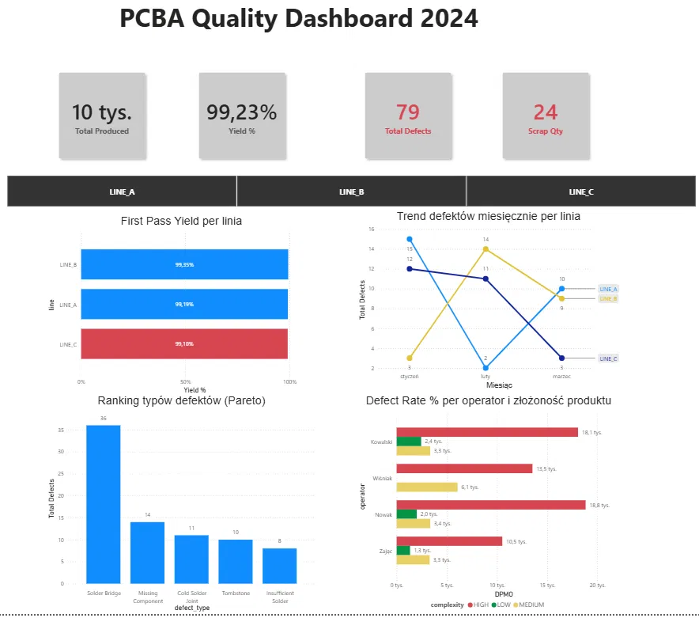

# 🔧 PCBA Quality Dashboard 2024

## Opis projektu

Analiza jakości produkcji elektronicznej (PCBA/SMT) dla trzech linii produkcyjnych.  
Celem projektu było zidentyfikowanie głównych źródeł defektów, ocena wydajności operatorów oraz monitorowanie trendów jakościowych w czasie.

Projekt oparty jest na danych syntetycznych, które przygotowałem samodzielnie (12 maszyn, 5 produktów, 20 zleceń, 31 rekordów defektów). Odwzorowują strukturę danych znaną z systemów MES/AOI, ale nie pochodzą z żadnego zakładu produkcyjnego. Znam ten typ danych z pracy jako planista produkcji.

---

## 🎯 Pytania biznesowe

- Która linia produkcyjna ma najniższy First Pass Yield (FPY)?
- Jakie typy defektów występują najczęściej i gdzie?
- Czy trend defektów poprawia się czy pogarsza w czasie?
- Który operator i przy jakim produkcie generuje najwięcej problemów?
- Jaki jest poziom DPMO w porównaniu do standardu Six Sigma?

---

## 🗂️ Struktura danych

```
production/
├── machines            # Maszyny i linie produkcyjne (12 rekordów)
├── products            # Produkty i klienci (5 rekordów)
├── production_orders   # Zlecenia produkcyjne (20 rekordów)
└── defects             # Zarejestrowane defekty z AOI (31 rekordów)
```

### Model danych (Star Schema)

```
[products] ──(product_id)──> [production_orders] <──(order_id)── [defects]
                                                                       ^
[machines] ──(machine_id)──────────────────────────────────────────────┘
```

---

## 🛠️ Technologie

| Narzędzie | Zastosowanie |
|-----------|-------------|
| Google BigQuery | Baza danych i zapytania SQL |
| SQL (BigQuery dialect) | Analiza danych: CTE, window functions, agregacje |
| Power BI Desktop | Wizualizacja i dashboard |
| DAX | Miary: FPY, DPMO, YoY, Defect Rate |

---

## 📊 Zakres analizy SQL

### Krok 1 — Yield per zlecenie produkcyjne
Obliczenie wskaźnika yield dla każdego zlecenia z uwzględnieniem defektów.  
**Techniki:** `LEFT JOIN`, `COALESCE`, `GROUP BY`, agregacje

### Krok 2 — First Pass Yield per linia
Porównanie FPY między liniami LINE_A, LINE_B, LINE_C z rankingiem.  
**Techniki:** `CTE`, `RANK() OVER`, `PARTITION BY`

### Krok 3 — Ranking typów defektów (Pareto)
Identyfikacja dominujących typów defektów per linia z udziałem procentowym.  
**Techniki:** dwa `CTE`, `RANK() OVER (PARTITION BY)`, `CASE WHEN`

### Krok 4 — Trend defektów miesięcznie
Analiza zmiany liczby defektów miesiąc do miesiąca per linia.  
**Techniki:** `FORMAT_DATE`, `LAG() OVER`, `PARTITION BY`, zmiana MoM %

### Krok 5 — Analiza operator vs produkt
Identyfikacja operatorów i produktów generujących największe straty jakościowe.  
**Techniki:** `CASE WHEN` w agregacji, `DIVIDE`, dwa `RANK()` w jednym zapytaniu

---

## 📐 Miary DAX (Power BI)

```dax
Yield %       = DIVIDE(produced - defects, produced) * 100
DPMO          = DIVIDE(defects, produced) * 1 000 000
Defect Rate % = DIVIDE(Total Defects, Total Produced) * 100
Scrap Qty     = CALCULATE(SUM(defects[defect_qty]), defects[rework_possible] = FALSE)
Total Produced PY = CALCULATE(SUM(produced_qty), SAMEPERIODLASTYEAR(order_date))
YoY Production %  = DIVIDE([Total Produced] - [Total Produced PY], [Total Produced PY]) * 100
```

---

## 🔍 Kluczowe wnioski

**1. LINE_C ma najniższy FPY (99,10%)** — najgorsza linia spośród trzech, jednak trend wskazuje poprawę w kolejnych miesiącach.

**2. Solder Bridge dominuje (36 z 79 defektów = 46%)** — główna przyczyna to prawdopodobnie parametry pasty lutowniczej lub kalibracja stencila. Wymaga analizy procesu reflow.

**3. Missing Component na LINE_A (14 defektów)** — wskazuje na problem z maszyną Pick & Place: kalibracja, feedery lub program montażu.

**4. Nowak ma najwyższe DPMO przy produktach HIGH complexity (18 800 DPMO)** — dla porównania standard Six Sigma to 3,4 DPMO. Rekomendacja: dodatkowe szkolenie lub weryfikacja ustawień maszyn przy produktach wysokiej złożoności.

**5. Trend pozytywny** — liczba defektów spada we wszystkich liniach między styczniem a marcem 2024. Działania korygujące przynoszą efekty.

---

## 📈 Dashboard Power BI



**Elementy dashboardu:**
- KPI Cards: Total Produced, Yield %, Total Defects, Scrap Qty
- First Pass Yield per linia (wykres słupkowy)
- Trend defektów miesięcznie per linia (wykres liniowy)
- Ranking typów defektów — Pareto (wykres kolumnowy)
- DPMO per operator i złożoność produktu (wykres słupkowy grupowany)
- Slicer: filtrowanie po linii produkcyjnej

---

## 📁 Struktura repozytorium

```
pcba-quality-analysis/
├── README.md
├── dashboard.png
└── sql/
    ├── 01_yield_per_order.sql
    ├── 02_fpy_per_line.sql
    ├── 03_defect_ranking_pareto.sql
    ├── 04_monthly_defect_trend.sql
    └── 05_operator_product_analysis.sql
```

